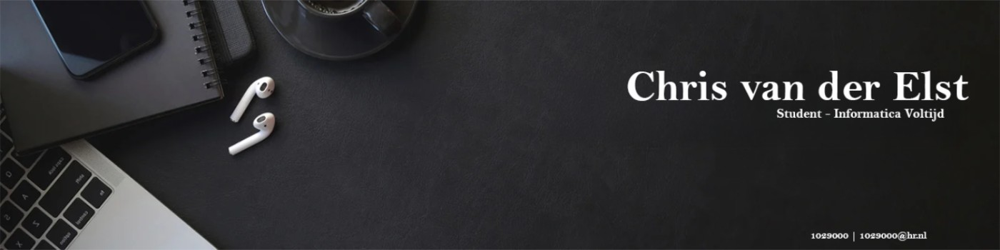
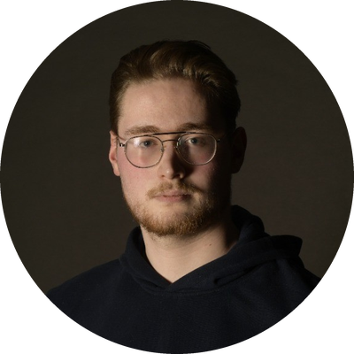

  

 

## About

I'm a fourth-year Informatics student (HBO) at Hogeschool Rotterdam, looking for a **graduation internship (from February 2027)** where I can help build real software and data solutions, preferably in a scrum team.

Most recently I interned at the data team of Gemeente Hoeksche Waard (Sep 2025 – Feb 2026) as a data analyst and process improver, working on Power BI reporting, an Azure Synapse ETL pipeline and Azure DevOps workflows. Alongside my studies I'm a peer coach in the CMI Informatica programme and work in a warehouse at PePe Parts B.V., where teamwork and reliability matter.

I'm now doing the Data Science minor and building a Docker homelab in my spare time. I document what I build, and I want to understand *why* something works, not just that it does.

## Timeline

> **◆ HBO Informatica · Hogeschool Rotterdam**  
> *Where it started*  
> Propedeuse completed after havo, followed by project-based education: building software in teams, tracking work in Jira and getting hands-on with Azure.  
>      
>
> **◆ Peer coach · CMI Informatica**  
> *Alongside my studies*  
> I support fellow students by explaining concepts and encouraging them to learn independently, which means listening first and then finding the explanation that fits the person.  
>   
>
> **◆ Vulcanex · Geological monitoring app**  
> *School project*  
> A cross-platform Flutter/Dart app with a CSV-based backend, structured with Clean Architecture and BLoC. Besides the code I delivered a heuristic evaluation (19 findings), user test plans and results, UML class and PlantUML component diagrams, and a future-development advice document. I learned to keep an app maintainable and to back design decisions with evidence instead of opinion.  
>      
>
> **◆ Internship · Gemeente Hoeksche Waard**  
> *Data team · Sep 2025 – Feb 2026*  
> I worked as data analyst and process improver: Power BI reports with KPIs, an ETL pipeline on Azure Synapse (medallion architecture), Azure DevOps workflows with Kanban/Scrum, and metadata analysis. I also wrote advisory reports on process optimisation, including a proof of concept for a single-source-of-truth wiki, which improved team transparency and onboarding.  
>       
>
> **◆ Homelab · HP Z210**  
> *Self-directed learning*  
> A home server on Ubuntu Server and Docker that doubles as my learning platform: Traefik as reverse proxy, Pi-hole for DNS filtering, Uptime Kuma for monitoring, Gitea for git and MinIO for object storage. I also built a Power BI ETL pipeline on top of it: raw bank exports cleaned with pandas in Jupyter, stored in MinIO and visualised in Power BI. It taught me networking basics, containers and what it takes to keep services running.  
>        
>
> **◆ Data Science minor** · *Now*  
> Working through regression and modelling, adding a statistical foundation to the software and dashboard work I've done so far.  
>  
>
> **◇ Graduation internship** · *Next, about 6 months*  
> Looking for a team where I can contribute to real software and data work while finishing my degree.

## Toolbox

       

       

## Beyond code

**Photography:** I shoot automotive, nature and portrait work on a Canon EOS 6D Mark II and publish it under the name CSVDE. [See the portfolio →](https://csvde.mypixieset.com/)

## Activity

 

Always happy to talk about software or data over a good coffee.

